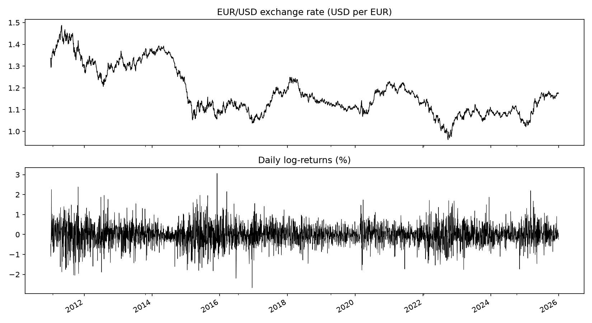
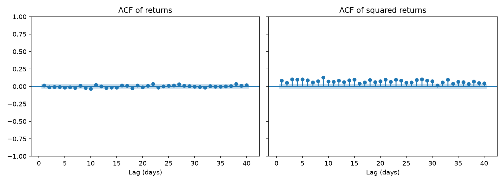
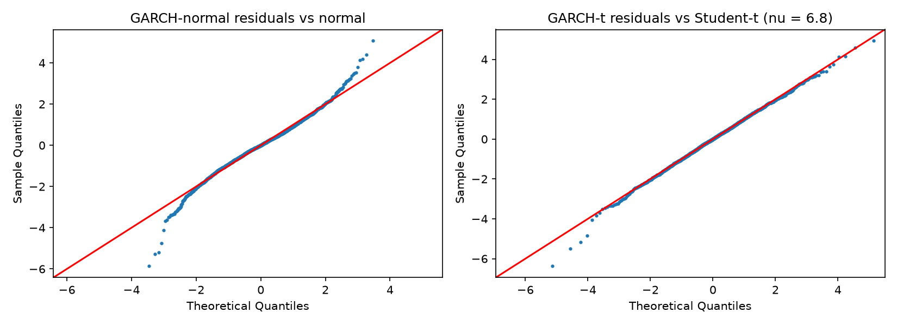
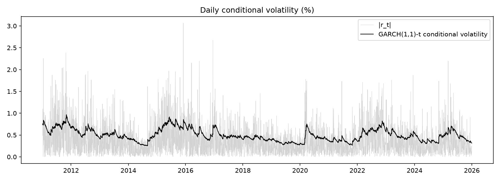
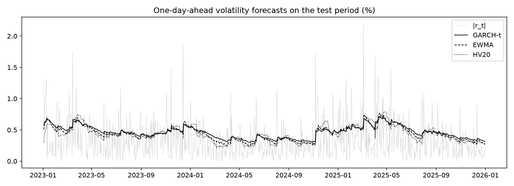

# EUR/USD Volatility Modeling with ARIMA-GARCH

Forecasting the daily volatility of EUR/USD with GARCH-family models,
compared with EWMA (RiskMetrics) and 20-day historical volatility.

## Summary
- **Data:** 15 years of daily EUR/USD (FRED DEXUSEU, 2011-2025), 3,750 log-returns.
- **Stylized facts:** fat tails (excess kurtosis 2.05, Jarque-Bera p < 0.001), no autocorrelation
  in returns but strong autocorrelation in squared returns (volatility clustering).
- **Mean:** no ARMA model beats the random walk (AIC, BIC and out-of-sample RMSE).
- **Variance:** GARCH-family models with Student-t innovations ($\nu \approx 6.8$) fit best;
  persistence above 0.99; small but significant asymmetry; all residual tests pass.
- **Forecasting (2023-2025):** GARCH-family models have the lowest QLIKE and MSE, but their
  gain over EWMA (about 1% in MSE) is not significant; both significantly beat 20-day
  historical volatility.

## Research question
For a risk manager, the key input is tomorrow's volatility. It is not
observable and it changes over time. This project asks: can GARCH-family
models forecast next-day EUR/USD volatility significantly better than
standard industry benchmarks (EWMA RiskMetrics, 20-day historical volatility)?
The goal is to forecast the size of the moves, not the direction of the rate.

## Setup
    python3 -m venv .venv
    source .venv/bin/activate
    pip install -r requirements.txt

Then open `main.ipynb` and run all cells.

## Data
- Source: FRED, series DEXUSEU (US dollars to one euro, noon buying rates in New York).
- Period: 2011-01-03 to 2025-12-31, daily, about 3,751 observations.
- Snapshot downloaded on 2026-11-15 and saved in `data/raw/`.
- Missing values (US holidays) are removed, not filled.
- Returns: daily log-returns in percent,

$$
r_t = 100 \times \ln\left(\frac{P_t}{P_{t-1}}\right)
$$

where $P_t$ is the EUR/USD rate on trading day $t$.

## Stylized facts

### Fat tails
Daily log-returns are almost symmetric but clearly not normal:

| Statistic | Value | Normal distribution |
|---|---|---|
| Skewness | 0.009 | 0 |
| Excess kurtosis | 2.05 | 0 |
| Jarque-Bera | 655.8 (p-value < 0.001) | 5% critical value: 5.99 |

The largest daily moves reach $+6.0\sigma$ and $-5.2\sigma$. Under a normal distribution,
moves beyond $5\sigma$ would be expected about 0.002 times in 15 years.
The QQ-plot shows the typical S shape of fat tails on both sides.

### Volatility clustering
Returns are not autocorrelated, but squared returns are strongly autocorrelated:
the direction of moves is not predictable, but their size is.

| Ljung-Box test | $Q(10)$ | p-value | $Q(20)$ | p-value |
|---|---|---|---|---|
| Returns $r_t$ | 10.6 | 0.39 | 20.7 | 0.42 |
| Squared returns $r_t^2$ | 294.7 | < 0.001 | 504.7 | < 0.001 |

Returns are therefore uncorrelated but not independent, which motivates a GARCH model
for the conditional variance.

### Stationarity
ADF ($H_0$: unit root) and KPSS ($H_0$: stationarity) give consistent conclusions:

| Series | ADF stat | ADF p-value | KPSS stat | KPSS p-value | Conclusion |
|---|---|---|---|---|---|
| Log price $\ln P_t$ | -2.05 | 0.27 | 5.42 | < 0.01 | non-stationary |
| Log-return $r_t$ | -60.42 | < 0.001 | 0.10 | > 0.10 | stationary |

The log price behaves like a random walk, so the models are fitted on log-returns.
(KPSS p-values are bounded to [0.01, 0.10] by the test's lookup table.)

## Mean model: ARIMA vs random walk
Log-returns are stationary, so ARMA(p, q) models with a constant were fitted on them
(equivalent to ARIMA(p, 1, q) on log prices), for $p, q \in \{0, 1, 2, 3\}$.
The random walk corresponds to ARMA(0, 0): $r_t = \mu + \varepsilon_t$.

**Information criteria.** Both AIC and BIC select ARMA(0, 0). No model improves on it:
the smallest difference is $\Delta \text{AIC} = +0.48$ for ARMA(2, 2).
The constant is not significant ($\hat\mu = -0.0035$, p-value 0.68).

**Out-of-sample test.** Parameters estimated on 2011-2022, one-step-ahead forecasts
on 2023-2025 (750 days):

| Model | RMSE | Ratio vs random walk |
|---|---|---|
| Random walk ($\hat r_t = 0$) | 0.4540 | 1.0000 |
| Constant mean | 0.4543 | 1.0006 |
| ARMA(1, 1) | 0.4546 | 1.0012 |

The conditional mean of EUR/USD returns is not predictable, consistent with market
efficiency. The variance models below therefore use a constant mean.

## Variance models: GARCH, GJR-GARCH, EGARCH
Constant mean $r_t = \mu + \varepsilon_t$, with $\varepsilon_t = \sigma_t z_t$ and three variance equations:

$$\text{GARCH(1,1)}: \quad \sigma_t^2 = \omega + \alpha\,\varepsilon_{t-1}^2 + \beta\,\sigma_{t-1}^2$$

$$\text{GJR-GARCH}: \quad \sigma_t^2 = \omega + \big(\alpha + \gamma\,\mathbb{1}_{\{\varepsilon_{t-1}<0\}}\big)\,\varepsilon_{t-1}^2 + \beta\,\sigma_{t-1}^2$$

$$\text{EGARCH}: \quad \ln\sigma_t^2 = \omega + \alpha\big(|z_{t-1}| - \mathbb{E}|z_{t-1}|\big) + \gamma\,z_{t-1} + \beta\,\ln\sigma_{t-1}^2$$

each with normal and Student-t innovations, estimated by maximum likelihood on 2011-2025.

| Model | Dist. | Log-lik | AIC | BIC | Persistence | Half-life (days) | $\gamma$ (p-value) | $\nu$ |
|---|---|---|---|---|---|---|---|---|
| GARCH | normal | -2563.0 | 5134.0 | 5158.9 | 0.993 | 105 | | |
| GARCH | t | -2484.9 | 4979.9 | **5011.0** | 0.997 | 245 | | 6.8 |
| GJR-GARCH | normal | -2560.7 | 5131.4 | 5162.5 | 0.994 | 121 | 0.015 (0.09) | |
| GJR-GARCH | t | -2482.5 | **4976.9** | 5014.3 | 0.998 | 325 | 0.018 (0.02) | 6.8 |
| EGARCH | normal | -2558.9 | 5127.8 | 5159.0 | 0.993 | 101 | -0.018 (0.04) | |
| EGARCH | t | -2483.4 | 4978.8 | 5016.1 | 0.996 | 183 | -0.020 (0.01) | 6.9 |

Persistence is $\alpha+\beta$ (GARCH), $\alpha+\gamma/2+\beta$ (GJR) or $\beta$ (EGARCH);
half-life $= \ln 0.5 / \ln(\text{persistence})$. GARCH(1,1)-t estimates: $\alpha = 0.038$, $\beta = 0.959$.

**Findings.**
- **Fat tails:** Student-t innovations improve the log-likelihood by about 78 points with
  $\nu \approx 6.8$. Residual excess kurtosis (about 1.9) is consistent with a Student-t
  ($6/(\nu-4) \approx 2.1$), not with a normal (0).
- **Persistence:** above 0.99, so volatility shocks last several months. Near 1, the
  half-life and the long-run variance $\omega/(1-\alpha-\beta)$ are imprecise.
- **Asymmetry:** small but significant in GJR and EGARCH: volatility rises more after a fall of the euro.
- **Model choice:** AIC selects GJR-GARCH-t, BIC selects GARCH-t. The out-of-sample evaluation decides.

### Diagnostics on standardized residuals (p-values, lag 10)

| | Ljung-Box $\hat z_t$ | Ljung-Box $\hat z_t^2$ | ARCH-LM |
|---|---|---|---|
| No model (constant volatility) | 0.39 | < 0.001 | < 0.001 |
| GARCH-t | 0.66 | 0.97 | 0.98 |
| GJR-GARCH-t | 0.62 | 0.95 | 0.96 |
| EGARCH-t | 0.58 | 0.79 | 0.81 |

All models remove the volatility clustering. The QQ-plots show that normal residuals
keep fat tails, while the Student-t fits them.

The conditional volatility ranges from about 0.25% to 1% per day. It rises quickly after
shocks (Covid, March 2020) and decays slowly, following the main stress periods
(2011-2012, 2015, 2020, 2022).

## Out-of-sample evaluation
**Setup.** For each day of 2023-2025 (750 days), each Student-t model is re-estimated on the
previous 3,000 days and forecasts the next day's variance. Benchmarks:

$$\text{EWMA}: \ \hat\sigma_t^2 = \lambda\,\hat\sigma_{t-1}^2 + (1-\lambda)\,r_{t-1}^2, \ \lambda = 0.94
\qquad \text{HV20}: \ \hat\sigma_t^2 = \frac{1}{20}\sum_{i=1}^{20} r_{t-i}^2$$

Forecasts $h_t$ are compared with the proxy $r_t^2$, which is unbiased but noisy, using

$$\text{MSE}_t = (r_t^2 - h_t)^2, \qquad \text{QLIKE}_t = \ln h_t + \frac{r_t^2}{h_t}$$

Both losses rank models consistently with a noisy proxy (Patton, 2011). QLIKE is the main
criterion: it is less sensitive to extreme days and penalizes underestimation more.
Differences are tested with Diebold-Mariano (Newey-West standard errors).

| Model | QLIKE | QLIKE - EWMA | MSE / EWMA |
|---|---|---|---|
| GJR-GARCH-t | -0.6286 | -0.0194 | 0.990 |
| EGARCH-t | -0.6274 | -0.0182 | 0.993 |
| GARCH-t | -0.6269 | -0.0177 | 0.994 |
| EWMA | -0.6092 | 0 | 1 |
| HV20 | -0.5157 | +0.0935 | 1.049 |

| Diebold-Mariano | QLIKE stat (p-value) | MSE stat (p-value) |
|---|---|---|
| GARCH-t vs EWMA | -1.24 (0.22) | -1.32 (0.19) |
| GJR-GARCH-t vs EWMA | -1.41 (0.16) | -1.55 (0.12) |
| EGARCH-t vs EWMA | -1.07 (0.28) | -0.79 (0.43) |
| GARCH-t vs HV20 | -2.79 (0.005) | -3.14 (0.002) |
| GJR-GARCH-t vs HV20 | -2.92 (0.003) | -3.44 (0.001) |
| EGARCH-t vs HV20 | -2.79 (0.005) | -3.26 (0.001) |
| HV20 vs EWMA | +3.14 (0.002) | +3.24 (0.001) |

A negative statistic means the first model is more accurate.

**Result.** The ranking is the same for both losses: GARCH-family models < EWMA < HV20.
The GARCH models reduce the MSE by about 1% relative to EWMA, but the difference is not
significant (p-values 0.12 to 0.43). This is consistent with the estimated persistence
(0.997), very close to EWMA's implicit value of 1: at a one-day horizon, the two models
are nearly identical. The small gain comes from mean reversion: in calm periods EWMA falls
lower (minimum forecast 0.062 vs 0.090 for GARCH-t) and underestimates volatility.
Both GARCH and EWMA significantly outperform 20-day historical volatility.

## Conclusion
EUR/USD daily returns are unpredictable in direction but not in size: volatility clusters,
moves in long regimes (persistence above 0.99), and has fat tails that a time-varying
volatility alone does not explain, so Student-t innovations are needed.

Out of sample, GARCH-type models give the best one-day volatility forecasts, but their
advantage over EWMA is small and not statistically significant. This is consistent with
the estimated persistence close to 1: at a one-day horizon, GARCH(1,1) and EWMA are very
similar models. GARCH adds estimated parameters and mean reversion toward a long-run level,
which protect against underestimating volatility in calm periods and matter more at
longer horizons. Both clearly outperform 20-day historical volatility.

## Limitations and extensions
- **Noisy proxy:** daily squared returns are a very noisy measure of true variance.
  Realized volatility from intraday data would give a sharper evaluation.
- **One horizon, one asset, one test period:** results are for one-day forecasts of
  EUR/USD on 2023-2025, a relatively calm period.
- **Persistence close to 1:** the half-life and the long-run variance are imprecise.
- **Extensions:** multi-day forecast horizons, VaR forecasts with backtesting
  (Kupiec and Christoffersen tests), other currency pairs, realized-volatility models.

## Project status
- [x] Project setup
- [x] Data and log-returns
- [x] Stylized facts and stationarity
- [x] Mean model (ARIMA vs random walk)
- [x] Variance models (GARCH, GJR, EGARCH) and diagnostics
- [x] Out-of-sample forecasting and evaluation