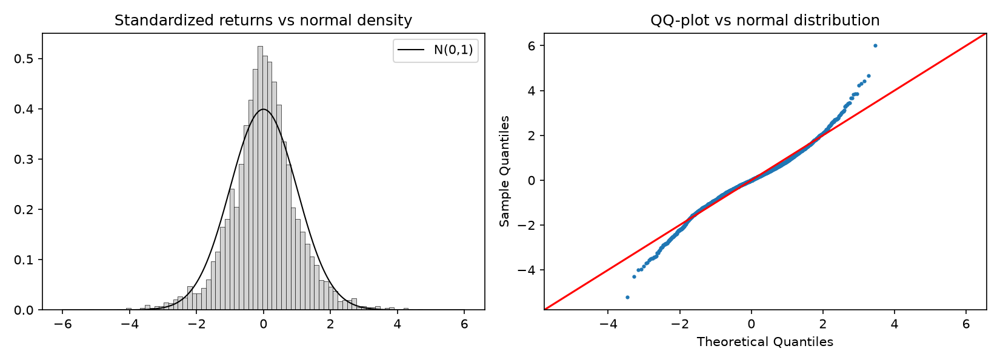

# EUR/USD Volatility Modeling with ARIMA-GARCH

Forecasting the daily volatility of EUR/USD with GARCH-family models,
compared with EWMA (RiskMetrics) and 20-day historical volatility.

## Research question
For a risk manager, the key input is tomorrow's volatility. It is not
observable and it changes over time. This project asks: can GARCH-family
models forecast next-day EUR/USD volatility significantly better than
standard industry benchmarks (EWMA RiskMetrics, 20-day historical volatility)?
The goal is to forecast the size of the moves, not the direction of the rate.

## Setup
    python3 -m venv .venv
    source .venv/bin/activate
    pip install -r requirements.txt

Then open `main.ipynb` and run all cells.

## Data
- Source: FRED, series DEXUSEU (US dollars to one euro, noon buying rates in New York).
- Period: 2011-01-03 to 2025-12-31, daily, about 3,751 observations.
- Snapshot downloaded on 2026-11-15 and saved in `data/raw/`.
- Missing values (US holidays) are removed, not filled.
- Returns: daily log-returns in percent,

$$
r_t = 100 \times \ln\left(\frac{P_t}{P_{t-1}}\right)
$$

where $P_t$ is the EUR/USD rate on trading day $t$.

## Stylized facts

### Fat tails
Daily log-returns are almost symmetric but clearly not normal:

| Statistic | Value | Normal distribution |
|---|---|---|
| Skewness | 0.009 | 0 |
| Excess kurtosis | 2.05 | 0 |
| Jarque-Bera | 655.8 (p-value < 0.001) | 5% critical value: 5.99 |

The largest daily moves reach $+6.0\sigma$ and $-5.2\sigma$. Under a normal distribution,
moves beyond $5\sigma$ would be expected about 0.002 times in 15 years.
The QQ-plot shows the typical S shape of fat tails on both sides.

### Volatility clustering
Returns are not autocorrelated, but squared returns are strongly autocorrelated:
the direction of moves is not predictable, but their size is.

| Ljung-Box test | $Q(10)$ | p-value | $Q(20)$ | p-value |
|---|---|---|---|---|
| Returns $r_t$ | 10.6 | 0.39 | 20.7 | 0.42 |
| Squared returns $r_t^2$ | 294.7 | < 0.001 | 504.7 | < 0.001 |

Returns are therefore uncorrelated but not independent, which motivates a GARCH model
for the conditional variance.

### Stationarity
ADF ($H_0$: unit root) and KPSS ($H_0$: stationarity) give consistent conclusions:

| Series | ADF stat | ADF p-value | KPSS stat | KPSS p-value | Conclusion |
|---|---|---|---|---|---|
| Log price $\ln P_t$ | -2.05 | 0.27 | 5.42 | < 0.01 | non-stationary |
| Log-return $r_t$ | -60.42 | < 0.001 | 0.10 | > 0.10 | stationary |

The log price behaves like a random walk, so the models are fitted on log-returns.
(KPSS p-values are bounded to [0.01, 0.10] by the test's lookup table.)

## Project status
- [x] Project setup
- [x] Data and log-returns
- [ ] Stylized facts and stationarity
- [ ] Mean model (ARIMA vs random walk)
- [ ] Variance models (GARCH, GJR, EGARCH) and diagnostics
- [ ] Out-of-sample forecasting and evaluation